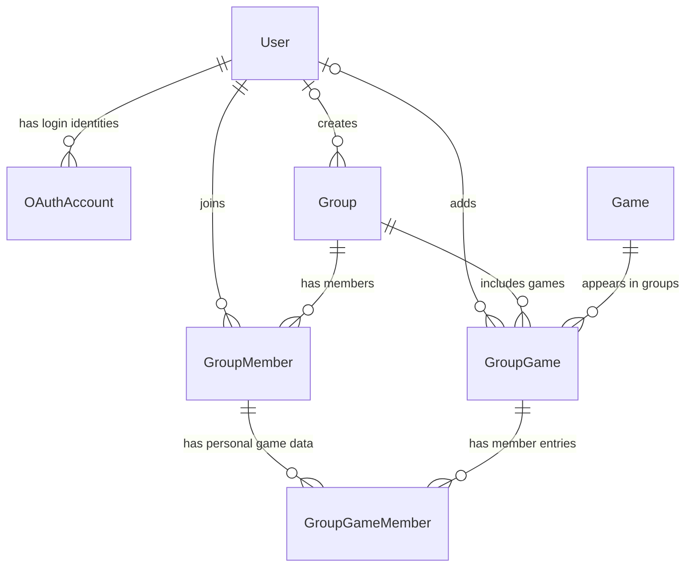

# Database schema

This document describes the database schema currently defined in [`prisma/schema.prisma`](prisma/schema.prisma). It is a reference for the present structure; planned product features may require future schema changes.

The database is PostgreSQL. Prisma manages the schema and its migration history is stored in `prisma/migrations/`.

## Entity relationship overview

`GroupGame` connects a catalog game to a group. `GroupGameMember` stores each member's interest, rating, and play status for that group game.

## Enums

### `GroupRole`

Role assigned to a user's membership in a group:

- `OWNER`
- `ADMIN`
- `MEMBER` (default)

### `GameStatus`

An individual member's status for a game in their group:

- `PLANNED` (default)
- `PLAYING`
- `COMPLETED`
- `DROPPED`

## Tables

### `User`

Application profile. The user's email address is not stored in this table.

| Column | Type | Rules | Meaning |
| --- | --- | --- | --- |
| `id` | `Int` | Primary key; auto-increment | Internal user ID |
| `nickname` | `String` | Unique | Public nickname selected in the app |
| `createdAt` | `DateTime` | Defaults to creation time | When the profile was created |

Relations: OAuth identities, group memberships, groups created by the user, and group games the user added.

### `OAuthAccount`

Links an application user to an external sign-in identity. For Google, `providerAccountId` is Google's stable account subject identifier; it is not the user's email.

| Column | Type | Rules | Meaning |
| --- | --- | --- | --- |
| `id` | `Int` | Primary key; auto-increment | Internal identity-link ID |
| `userId` | `Int` | Foreign key to `User.id` | Owning application user |
| `provider` | `String` | Unique together with `providerAccountId` | Provider name, currently `google` |
| `providerAccountId` | `String` | Unique together with `provider` | Stable identifier assigned by the provider |
| `createdAt` | `DateTime` | Defaults to creation time | When the identity was linked |

Constraints and relations:

- Unique pair: (`provider`, `providerAccountId`). One external identity can link to only one app user.
- Index on `userId` for looking up identities by user.
- Deleting the user cascades to their OAuth identity links.

### `Group`

A shared space for friends planning games together.

| Column | Type | Rules | Meaning |
| --- | --- | --- | --- |
| `id` | `Int` | Primary key; auto-increment | Group ID |
| `name` | `String` | Required | Group name |
| `createdById` | `Int?` | Optional foreign key to `User.id` | User who created the group |
| `createdAt` | `DateTime` | Defaults to creation time | When the group was created |

Relations: optional creator, memberships, and games added to the group. If the creator is deleted, the group remains and `createdById` becomes `null`.

### `GroupMember`

Membership connecting a user to a group, including their role.

| Column | Type | Rules | Meaning |
| --- | --- | --- | --- |
| `id` | `Int` | Primary key; auto-increment | Membership ID |
| `groupId` | `Int` | Foreign key to `Group.id` | Group joined |
| `userId` | `Int` | Foreign key to `User.id` | Member |
| `role` | `GroupRole` | Defaults to `MEMBER` | Permissions role in this group |
| `joinedAt` | `DateTime` | Defaults to creation time | When the membership was created |

Constraints and relations:

- Unique pair: (`groupId`, `userId`). A user can have only one membership in a given group.
- Index on `userId` for finding a user's groups.
- Deleting a group or user cascades to the membership and its dependent personal game entries.

### `Game`

Shared game catalog. A catalog entry can be referenced by multiple groups.

| Column | Type | Rules | Meaning |
| --- | --- | --- | --- |
| `id` | `Int` | Primary key; auto-increment | Internal game ID |
| `title` | `String` | Required | Game title |
| `steamAppId` | `Int?` | Optional; unique when present | Steam application ID |
| `coverUrl` | `String?` | Optional | URL of the game's cover image |
| `createdAt` | `DateTime` | Defaults to creation time | When the catalog entry was created |

Deleting a game is restricted while a `GroupGame` refers to it. This prevents a catalog entry from being removed while groups use it.

### `GroupGame`

Adds a catalog game to a group. It records who added it and when; member-specific data is stored separately in `GroupGameMember`.

| Column | Type | Rules | Meaning |
| --- | --- | --- | --- |
| `id` | `Int` | Primary key; auto-increment | Group-game link ID |
| `groupId` | `Int` | Foreign key to `Group.id` | Group containing the game |
| `gameId` | `Int` | Foreign key to `Game.id` | Catalog game |
| `addedById` | `Int?` | Optional foreign key to `User.id` | User who added the game |
| `addedAt` | `DateTime` | Defaults to creation time | When it was added |

Constraints and relations:

- Unique pair: (`groupId`, `gameId`). The same catalog game can only be added once to a given group.
- Index on `gameId` for finding groups that use a game.
- Deleting the group cascades to its group-game links. Deleting the game is restricted while links exist.
- Deleting the user who added it preserves the link and sets `addedById` to `null`.

### `GroupGameMember`

Stores a member's personal information about a game added to their group: interest, rating, and progress status.

| Column | Type | Rules | Meaning |
| --- | --- | --- | --- |
| `id` | `Int` | Primary key; auto-increment | Personal game-entry ID |
| `groupGameId` | `Int` | Foreign key to `GroupGame.id` | Game in the group |
| `groupMemberId` | `Int` | Foreign key to `GroupMember.id` | Membership this entry belongs to |
| `interestScore` | `Int?` | Optional | Member's interest score |
| `gameRating` | `Int?` | Optional | Member's rating after playing |
| `status` | `GameStatus` | Defaults to `PLANNED` | Member's individual progress |
| `createdAt` | `DateTime` | Defaults to creation time | When this entry was created |
| `updatedAt` | `DateTime` | Automatically updated by Prisma | When this entry was last updated |

Constraints and relations:

- Unique pair: (`groupGameId`, `groupMemberId`). One membership has at most one personal entry for a group game.
- Index on `groupMemberId` for finding a member's personal game entries.
- Deleting the group game or membership cascades to this entry.
- The current schema does not define minimum or maximum values for `interestScore` or `gameRating`.
- The database schema does not enforce that `groupMember` belongs to the same group as `groupGame`; application logic must validate this when creating or changing an entry.

## Relationship and deletion summary

- A `User` may have multiple OAuth identities and group memberships.
- A `Group` contains memberships and group-game links.
- A `Game` can be shared among many groups through `GroupGame`.
- A `GroupGameMember` row belongs to one group-game link and one group membership.
- Cascading deletion removes dependent membership, group-game, and personal game rows where configured.
- Deleting a user preserves groups they created and games they added by setting the optional creator/adder reference to `null`.
- Deleting a game with existing group links is blocked (`Restrict`).

## Not currently stored

- Google email, name, and profile image.
- A preferred language on the user profile.
- Steam descriptions, player counts, release status, supported languages, or cached store metadata.
- Playthrough/history records separate from the current member status.

